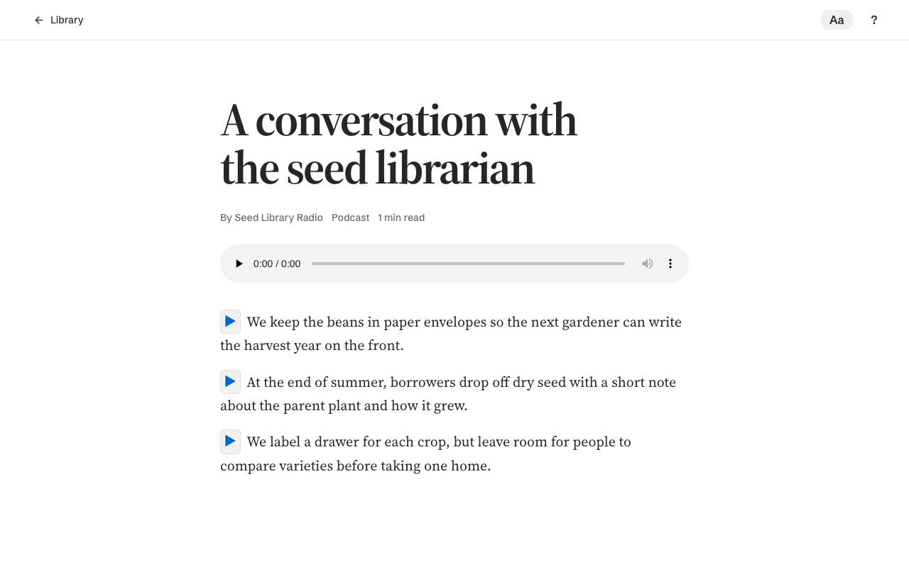
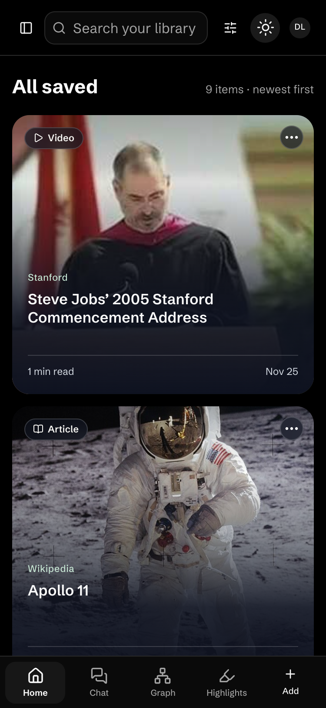

<h1 align="center">
  <a href="docs/media/brand/logo-light.svg#gh-light-mode-only">
    <picture></picture>
  </a>
  <a href="docs/media/brand/logo-dark.svg#gh-dark-mode-only">
    <picture></picture>
  </a>
</h1>

<h3 align="center">Remember everything you read, watch and hear.</h3>

<p align="center">
  A private memory for everything you come across: articles, YouTube videos, podcasts, PDFs, screenshots and notes, kept on your own server.<br>
  Find anything by what it meant. Ask it a question. Every answer points to the exact passage, or the exact moment, it came from.
</p>

<p align="center">
  <a href="#quick-start"><strong>Install</strong></a> ·
  <a href="#everything-you-come-across">What it remembers</a> ·
  <a href="#ask-your-memory">Ask</a> ·
  <a href="#how-it-works">How it works</a> ·
  <a href="docs/README.md">Docs</a> ·
  <a href="CHANGELOG.md">Changelog</a>
  <!-- TODO(owner): Demo instance, Discord and hosted edition links -->
</p>

<p align="center">
  <a href="https://github.com/Akshaysanthosh/absolute-memory/actions/workflows/ci.yml"></a>
  
  
  
  <!-- TODO(owner): latest release and Docker pulls badges after the first release -->
  <!-- TODO(owner): licence -->
</p>

<a href="docs/media/readme/hero-light.svg#gh-light-mode-only">
  <picture></picture>
</a>
<a href="docs/media/readme/hero-dark.svg#gh-dark-mode-only">
  <picture></picture>
</a>

## Why a memory, not a bookmark list

You read an article in March, heard a podcast in June and watched a video last week. You remember the idea, but not where it came from.

A bookmark keeps the link. **Absolute Memory keeps what was said.** It saves the text of the article, the transcript of the video or podcast, and the words in the PDF or screenshot. All of it becomes numbered passages you can search, highlight, ask about and cite, on a server you control.

## See it in action


<sub>Save, highlight, ask, then follow the citation back to the source. [Watch the MP4](docs/media/demo.mp4).</sub>

## Everything you come across

| You come across…                 | Absolute Memory keeps                                                                                                                         |
| -------------------------------- | --------------------------------------------------------------------------------------------------------------------------------------------- |
| 📰 **An article**                | The readable text, lead image, author and site, split into numbered passages                                                                  |
| ▶️ **A YouTube video**           | Its captions as a timed transcript. With a transcription provider, it transcribes the audio when there are no captions                        |
| 🎙️ **A podcast episode**         | The show's published transcript, or a transcript of the audio. Apple Podcasts and Spotify links are matched to the public feed                |
| 📱 **A video on another site**   | Captions or a transcript when the site allows it, using the bundled yt-dlp                                                                    |
| 📄 **A PDF**                     | Its text by page, plus the original file                                                                                                      |
| 🖼️ **A screenshot or photo**     | A title, a short description and the text in the image, when a vision-capable model is configured                                             |
| 🎧 **A voice memo or recording** | A timed transcript of your uploaded audio or video                                                                                            |
| ❝ **A line on any web page**     | The quote and its page, saved from the Chromium extension                                                                                     |
| ✏️ **A thought of your own**     | A note, searchable alongside everything else                                                                                                  |
| 📊 **A spreadsheet**             | The original `.xlsx` and its sheet count, kept with the rest of your memory. Its cells are not searchable yet                                 |
| 📦 **Years of saved reading**    | Imports from Pocket, Instapaper, Omnivore, Readwise Reader, Raindrop.io and browser bookmarks, with highlights where the export includes them |

Supported sites, limits and cookies for authorised downloads are in the [media guide](docs/media.md). Imports are in [import and export](docs/import-export.md).

## Ask your memory


- **Find it the way you remember it.** Full-text search works out of the box. Add an embedding model to search by meaning, so "that talk about seed libraries" can find the episode even when it used other words.
- **Answers with receipts.** Ask in plain language. The answer is written only from your saved passages, and each claim carries a numbered citation.
- **One click back to the source.** A citation opens the reader at that passage and outlines it. In a podcast or video transcript, each passage has a play button that starts the recording from that line.
- **Topics without filing.** With AI configured, saved items get tags and a short summary, and the library groups them into topics.

## Read, listen and highlight

<table>
  <tr>
    <td width="50%"></td>
    <td width="50%"></td>
  </tr>
  <tr>
    <td><sub><strong>A calm reader.</strong> Light or dark, adjustable type, and your place is saved. Select text and press <kbd>H</kbd> to highlight.</sub></td>
    <td><sub><strong>Transcripts you can read.</strong> Podcasts and videos become text. Press play on any line to hear it.</sub></td>
  </tr>
  <tr>
    <td></td>
    <td align="center"></td>
  </tr>
  <tr>
    <td><sub><strong>Dark mode</strong> for late-night reading.</sub></td>
    <td align="center"><sub><strong>Works on your phone</strong> in the browser.</sub></td>
  </tr>
</table>

## Bring your memory to your AI tools

Absolute Memory includes a local [MCP server](docs/mcp.md). An MCP client such as Claude Desktop or Cursor can search your memory, read passages and highlights, ask with citations and save new links. A scoped key decides whether a tool can only read or can also save.

```text
search_memory · get_item · list_recent · list_highlights · ask_memory · save_url
```

The same scoped keys work with the [HTTP API](docs/api.md) and the [CLI](docs/cli.md).

## How it works

<a href="docs/media/readme/how-it-works-light.svg#gh-light-mode-only">
  <picture></picture>
</a>
<a href="docs/media/readme/how-it-works-dark.svg#gh-dark-mode-only">
  <picture></picture>
</a>

Everything you save becomes the same thing: **numbered passages**, with timestamps for audio and video. Highlights are anchored to passages, search and Ask retrieve passages, and citations link back to them. That is how an answer can point to one sentence in a long PDF or one line of an hour-long episode.

A Next.js app and a background worker do the work. **Lite** runs everything in one container with embedded PGlite. **Standard** uses PostgreSQL with pgvector and can keep files in S3-compatible storage. [Architecture](docs/architecture/overview.md)

## Private by design

- **Your server, your files.** What you save, including the original PDFs, images and workbooks, stays on your instance.
- **AI is optional and off by default.** Reading, highlights, keyword search, import and export all work without it.
- **Bring your own model.** Chat and summaries use any OpenAI-compatible endpoint, such as OpenAI, DeepSeek or OpenRouter, or local models through Ollama or LM Studio. [Providers](docs/providers.md)
- **No telemetry.** When you save a link, your instance fetches it. When you configure AI, the passages, files or audio a feature needs go to the endpoint you chose. [Privacy and network use](docs/privacy.md)
- **Leave any time.** Export everything as a ZIP in a [documented format](docs/export-format.md): items and passages, highlights, notes, chats and your original files.

## Quick start

With Git, Docker and OpenSSL installed:

```sh
git clone https://github.com/Akshaysanthosh/absolute-memory.git
cd absolute-memory
docker build -t absolute-memory:local .
docker run -d --name absolute-memory -p 127.0.0.1:3000:3000 \
  -v absolute-memory-data:/data \
  -e AUTH_SECRET="$(openssl rand -base64 32)" absolute-memory:local
```

Open [localhost:3000](http://localhost:3000), create the owner account and save your first link with **Add**. The image includes yt-dlp and FFmpeg for video and podcast capture. To turn on Ask, semantic search and transcription, add a provider in [configuration](docs/configuration.md).

<details>
<summary>Prebuilt image (available after the first release)</summary>

```sh
docker run -d --name absolute-memory -p 127.0.0.1:3000:3000 \
  -v absolute-memory-data:/data \
  -e AUTH_SECRET="$(openssl rand -base64 32)" ghcr.io/akshaysanthosh/absolute-memory:0.1.0
```

</details>

<details>
<summary>Standard deployment, or development without Docker</summary>

For separate web, worker and PostgreSQL services, follow [Standard](docs/getting-started.md#standard). To develop with Node.js 22, run `npm ci` and `npm run dev` in the clone. See [local development](docs/getting-started.md#local-development) for media tools and the mock AI provider.

</details>

## How it compares

Read-later apps and bookmark managers are built around the link. Note apps are built around what you write. Chat-with-your-documents apps are built around files you upload. Absolute Memory is built around **what you consume**, kept as text you can cite, including what you only listened to or watched.

<details>
<summary>Feature comparison with self-hosted read-later and bookmark apps</summary>

A dash means the feature is not listed in the official documentation reviewed on 22 November 2026.

| Project                                                | Self-hosted | Reader highlights | AI answers with passage citations | MCP server                                         | Documented export                                                                             | Status                                                        |
| ------------------------------------------------------ | ----------- | ----------------- | --------------------------------- | -------------------------------------------------- | --------------------------------------------------------------------------------------------- | ------------------------------------------------------------- |
| **Absolute Memory**                                    | Yes         | Yes               | Yes, with chat configured         | Yes, local stdio                                   | [Portable ZIP and schema](docs/export-format.md)                                              | Release candidate                                             |
| [Karakeep](https://github.com/karakeep-app/karakeep)   | Yes         | Yes               | —                                 | [Yes](https://docs.karakeep.com/integrations/mcp/) | [CLI migration](https://docs.karakeep.com/administration/server-migration/)                   | Maintained                                                    |
| [Linkwarden](https://github.com/linkwarden/linkwarden) | Yes         | Yes               | —                                 | —                                                  | [JSON backup](https://docs.linkwarden.app/usage/import-and-export)                            | Maintained                                                    |
| [Readeck](https://codeberg.org/readeck/readeck)        | Yes         | Yes               | —                                 | —                                                  | [EPUB](https://codeberg.org/readeck/readeck/src/branch/main/README.md)                        | Maintained                                                    |
| [wallabag](https://doc.wallabag.org/)                  | Yes         | Yes               | —                                 | —                                                  | [Article downloads, including JSON and PDF](https://doc.wallabag.org/user/articles/download/) | Maintained                                                    |
| [Omnivore](https://github.com/omnivore-app/omnivore)   | Yes         | Yes               | —                                 | —                                                  | —                                                                                             | Hosted service closed in 2024. Self-hosted project continues. |

Karakeep and Linkwarden offer native mobile apps. Linkwarden supports shared collections, and Readeck exports collections for e-readers. If native offline reading, collaborative bookmarking or EPUB export matters more to you than asking questions with citations, one of those may fit better.

</details>

## Documentation

| Get started                                                                                                   | Use it                                                                                                               | Connect                                                             | Run it well                                                                                   |
| ------------------------------------------------------------------------------------------------------------- | -------------------------------------------------------------------------------------------------------------------- | ------------------------------------------------------------------- | --------------------------------------------------------------------------------------------- |
| [Install](docs/getting-started.md)<br>[Configure](docs/configuration.md)<br>[AI providers](docs/providers.md) | [Videos and podcasts](docs/media.md)<br>[Import and export](docs/import-export.md)<br>[Extension](docs/extension.md) | [MCP](docs/mcp.md)<br>[HTTP API](docs/api.md)<br>[CLI](docs/cli.md) | [Backups](docs/backup.md)<br>[Upgrading](docs/upgrading.md)<br>[Hardening](docs/hardening.md) |

All guides are in [docs](docs/README.md). The same pages build into a docs website from [`website/`](website/).

## Contributing

See [Contributing](CONTRIBUTING.md) for setup and the checks to run, and [Security](SECURITY.md) for private vulnerability reporting.

<!-- TODO(owner): community links, contributors image and star-history chart -->

## Licence

Licence to be announced. [Licence status](LICENSE-PENDING.md)

<!-- TODO(owner): licence -->
