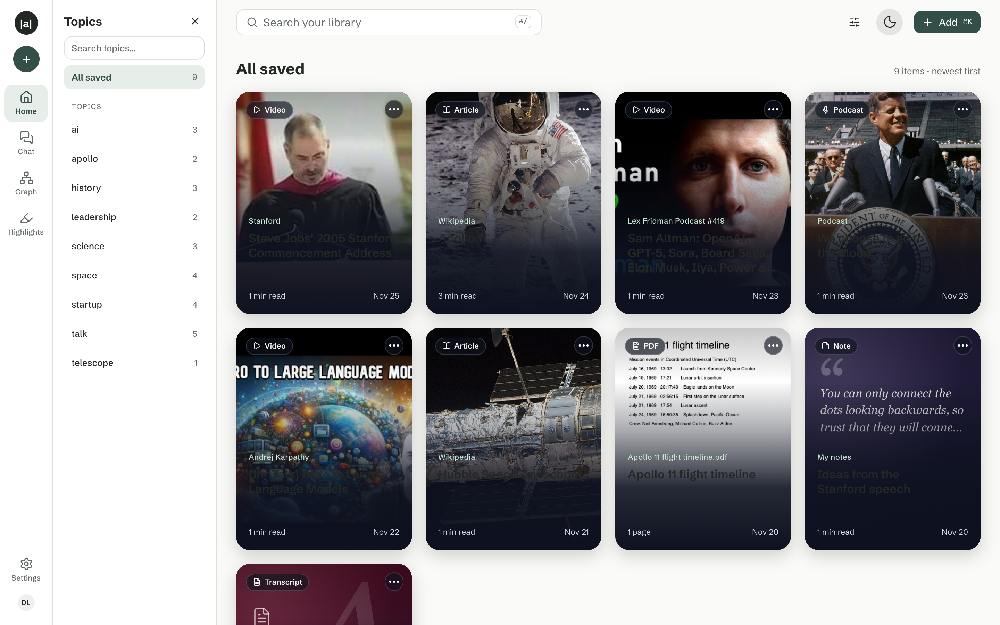
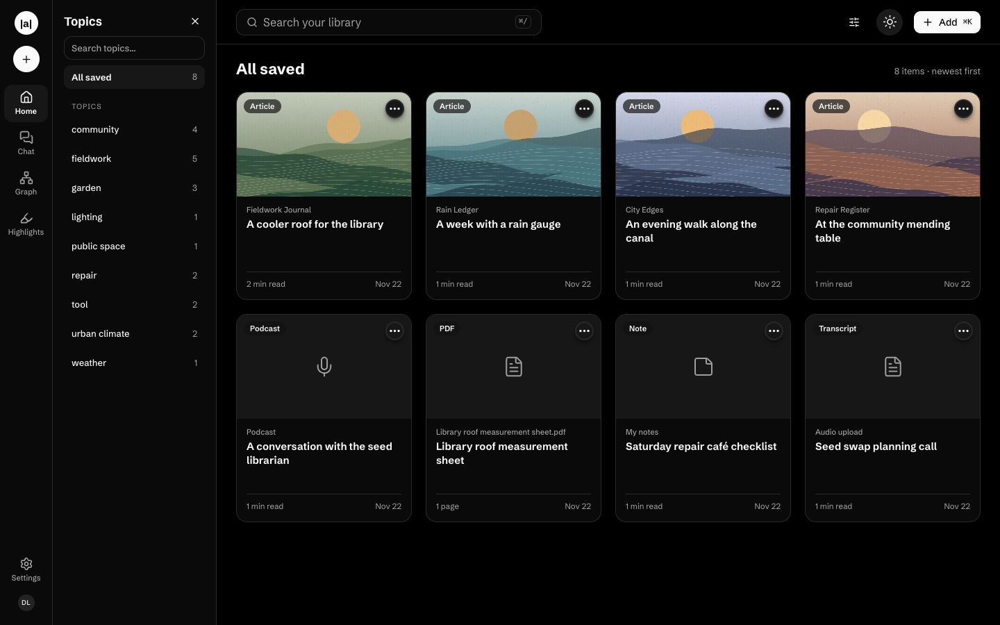
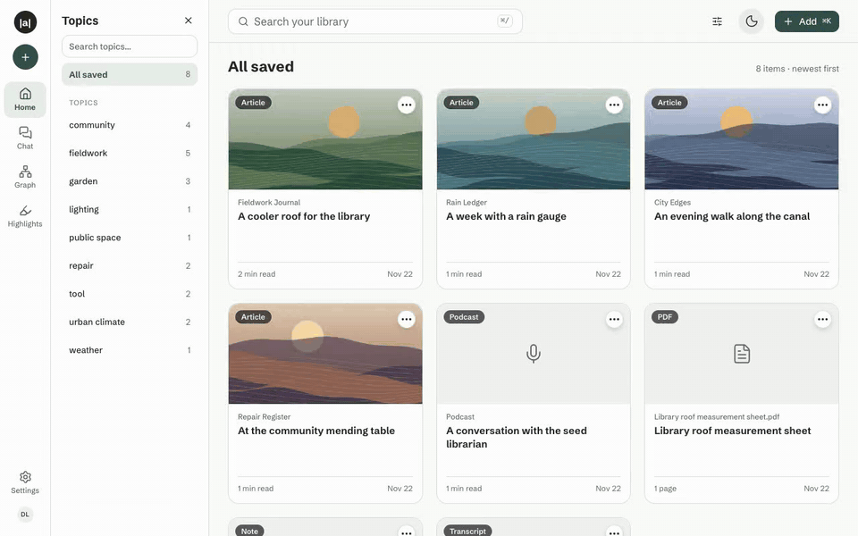
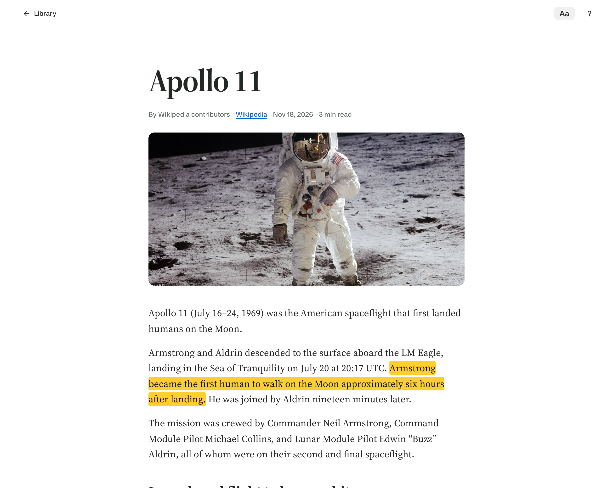
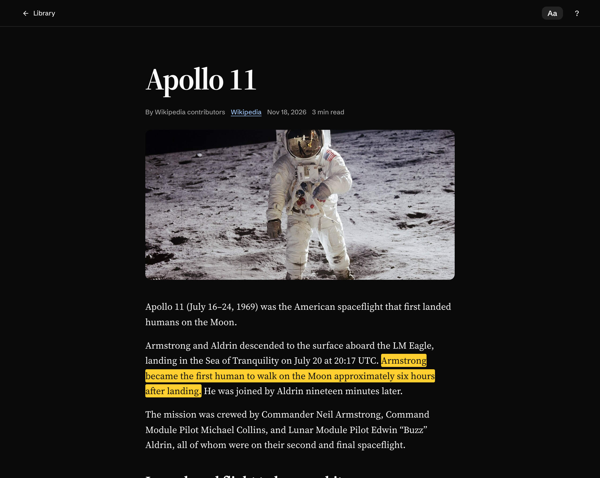
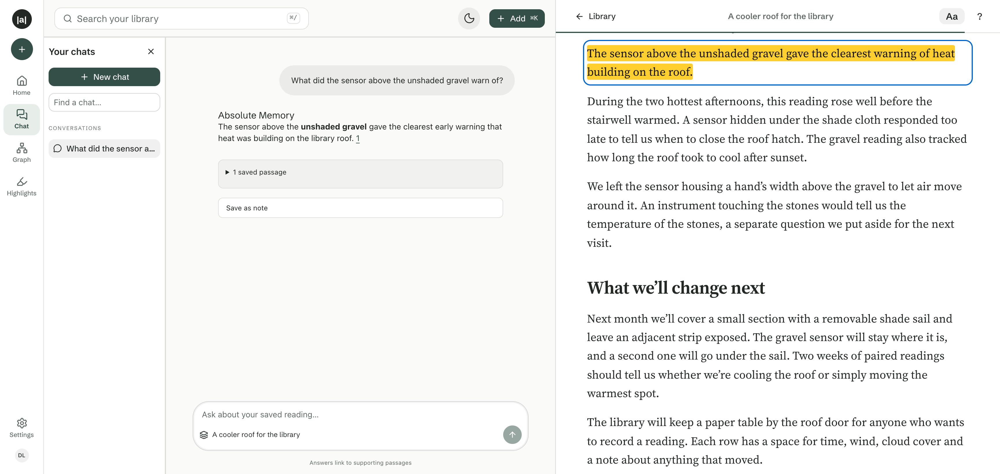
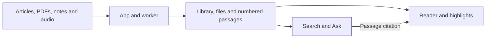

<h1 align="center">
  <a href="docs/media/brand/logo-light.svg#gh-light-mode-only">
    <picture></picture>
  </a>
  <a href="docs/media/brand/logo-dark.svg#gh-dark-mode-only">
    <picture></picture>
  </a>
</h1>

<p align="center"><strong>Your reading library, with answers that cite the page.</strong></p>

<p align="center">Save articles, PDFs, notes and podcasts in a library you run yourself. Highlight what matters, find it again, and follow answers back to the passages they came from.</p>

<p align="center">
  <a href="#quick-start">Install</a> · <a href="#documentation">Docs</a> · <a href="#features">Features</a> · <a href="#alternatives">Alternatives</a> · <a href="CHANGELOG.md">Changelog</a>
  <!-- TODO(owner): Demo instance and Discord -->
  <!-- TODO(owner): hosted edition link -->
</p>

<p align="center">
  <a href="https://github.com/Akshaysanthosh/absolute-memory/actions/workflows/ci.yml">
    
  </a>
  <!-- TODO(owner): latest release and Docker pulls badges after the first release -->
  <!-- TODO(owner): licence -->
</p>

<a href="docs/media/library.png#gh-light-mode-only">
  <picture></picture>
</a>
<a href="docs/media/library-dark.png#gh-dark-mode-only">
  <picture></picture>
</a>



[Watch the MP4](docs/media/demo.mp4)

## Features

### Save

- **Keep articles, PDFs and notes together.** Save article URLs, upload documents, or write a note from the library.
- **Read what you listened to.** Save supported podcast episodes and read timed transcripts when a source or configured transcription provider supplies them.

### Read

- **Mark the passage.** Highlight text in the reader and jump back to it from your Highlights list.
- **Read comfortably.** Choose light or dark appearance, adjust typography, and pick up from your saved position.

### Find and ask

- **Find words or meaning.** Use full-text search by default. Add an embedding provider for semantic search.
- **Answers with passage citations.** Configure a chat provider to ask your library a question and follow the answer back to the saved text.
- **Revisit a topic.** Browse tags and summaries. With AI configured, the experimental graph can show links between extracted entities and saved items.

### Connect

- **Save from Chromium.** Pair the extension to capture a page or selected text.
- **Connect other tools.** Use scoped keys with the HTTP API, CLI, or local stdio MCP server.

### Own your data

- **Move or back up a library.** Export a portable ZIP with [a documented format](docs/export-format.md), or follow the [instance backup guide](docs/backup.md) for recovery.

## Quick start

With Git, Docker and OpenSSL installed, build the Lite image and start it on your machine.

```sh
git clone https://github.com/Akshaysanthosh/absolute-memory.git
cd absolute-memory
docker build -t absolute-memory:local .
docker run -d --name absolute-memory -p 127.0.0.1:3000:3000 \
  -v absolute-memory-data:/data \
  -e AUTH_SECRET="$(openssl rand -base64 32)" absolute-memory:local
```

Open [localhost:3000](http://localhost:3000), create the owner account, then select **Add** to save your first article. Lite keeps the app, worker and database in one container. Keep the data volume when replacing it. For separate web, worker and PostgreSQL services, use [Standard](docs/getting-started.md#standard).

### Use the prebuilt image

**Available after the first release.**

```sh
docker run -d --name absolute-memory -p 127.0.0.1:3000:3000 \
  -v absolute-memory-data:/data \
  -e AUTH_SECRET="$(openssl rand -base64 32)" ghcr.io/akshaysanthosh/absolute-memory:0.1.0
```

<details>
<summary>Build from source without Docker</summary>

With Node.js 22, run the following inside the clone. Open [localhost:3000](http://localhost:3000).

```sh
npm ci
npm run dev
```

The development app uses embedded PGlite. See [local development](docs/getting-started.md#local-development) for media tools and the mock AI provider.

</details>

## Screenshots

<table>
  <tr>
    <td><a href="docs/media/reader-light.png"></a><br>Reader, light</td>
    <td><a href="docs/media/reader-dark.png"></a><br>Reader, dark</td>
  </tr>
  <tr>
    <td><a href="docs/media/ask-citation.png"></a><br>Ask with citation</td>
    <td><a href="docs/media/library-mobile.png"></a><br>Mobile library</td>
  </tr>
</table>

## Privacy and AI

AI is optional and off by default. Reading, highlights, keyword search and library transfers work without it. Chat and summaries use an OpenAI-compatible endpoint, such as OpenAI, DeepSeek, OpenRouter, Ollama or LM Studio. Local models work through Ollama or LM Studio when their endpoint is reachable by the instance. [Provider setup](docs/providers.md)

When you save a link, your instance contacts its source. If you configure AI, the relevant prompts, saved passages, files or audio go to the endpoint you choose when that feature needs them. The app sends no telemetry. [Privacy and network use](docs/privacy.md)

## Alternatives

A dash means the feature is unlisted in the official documentation reviewed. The table covers built-in features and documented integrations.

| Project                                                | Self-hosted | Reader highlights | AI answers with passage citations | MCP server                                         | Documented export                                                                             | Status                                                        |
| ------------------------------------------------------ | ----------- | ----------------- | --------------------------------- | -------------------------------------------------- | --------------------------------------------------------------------------------------------- | ------------------------------------------------------------- |
| **Absolute Memory**                                    | Yes         | Yes               | Yes, with chat configured         | Yes, local stdio                                   | [Portable ZIP and schema](docs/export-format.md)                                              | Release candidate                                             |
| [Karakeep](https://github.com/karakeep-app/karakeep)   | Yes         | Yes               | —                                 | [Yes](https://docs.karakeep.com/integrations/mcp/) | [CLI migration](https://docs.karakeep.com/administration/server-migration/)                   | Maintained                                                    |
| [Linkwarden](https://github.com/linkwarden/linkwarden) | Yes         | Yes               | —                                 | —                                                  | [JSON backup](https://docs.linkwarden.app/usage/import-and-export)                            | Maintained                                                    |
| [Readeck](https://codeberg.org/readeck/readeck)        | Yes         | Yes               | —                                 | —                                                  | [EPUB](https://codeberg.org/readeck/readeck/src/branch/main/README.md)                        | Maintained                                                    |
| [wallabag](https://doc.wallabag.org/)                  | Yes         | Yes               | —                                 | —                                                  | [Article downloads, including JSON and PDF](https://doc.wallabag.org/user/articles/download/) | Maintained                                                    |
| [Omnivore](https://github.com/omnivore-app/omnivore)   | Yes         | Yes               | —                                 | —                                                  | —                                                                                             | Hosted service closed in 2024. Self-hosted project continues. |

Karakeep and Linkwarden offer native mobile apps. Linkwarden supports shared collections, and Readeck exports collections for e-readers. If native offline reading, collaborative bookmarking, or EPUB export matters more than asking questions with passage citations, one of those projects may fit better.

## How it works

The Next.js app and a background worker extract readable content and store numbered passages and original files. Lite uses embedded PGlite and local storage, while Standard uses PostgreSQL with pgvector and can use S3-compatible storage. The reader anchors highlights to passages, and Ask retrieves from those same passages to link an answer to its source. [Architecture](docs/architecture/overview.md)



## Documentation

Run the [docs website](website/) locally, or start with a guide on GitHub.

- [Install](docs/getting-started.md) · [Configure](docs/configuration.md) · [AI providers](docs/providers.md)
- [Import and export](docs/import-export.md) · [Backups](docs/backup.md) · [Upgrading](docs/upgrading.md)
- [MCP](docs/mcp.md) · [Extension](docs/extension.md) · [CLI](docs/cli.md) · [HTTP API](docs/api.md)
- [All guides](docs/README.md) · [Privacy](docs/privacy.md) · [Hardening](docs/hardening.md)

## Contributing

See [Contributing](CONTRIBUTING.md) for setup and checks, and [Security](SECURITY.md) for private vulnerability reporting.

<!-- TODO(owner): community links, Twitter, contributors image and star-history chart -->

## Licence

Licence to be announced. [Licence status](LICENSE-PENDING.md)

<!-- TODO(owner): licence -->
