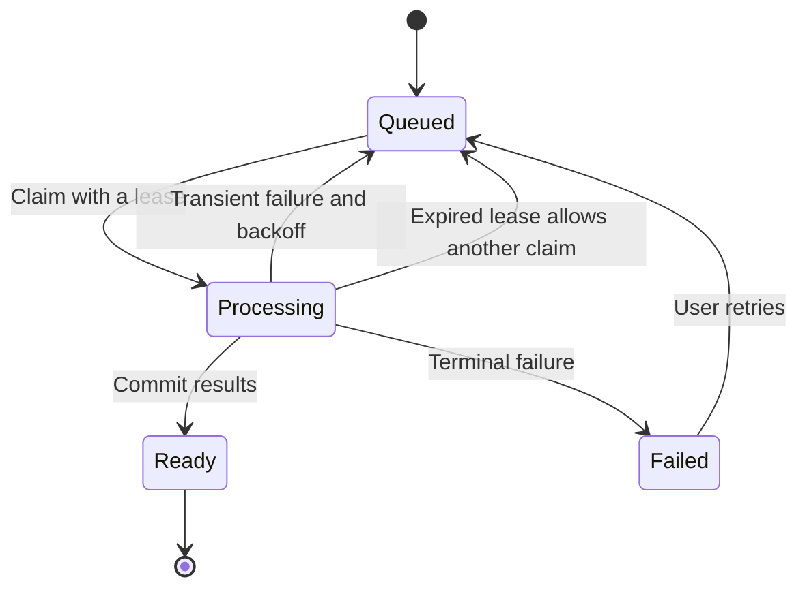

# Background jobs

Capture records a save and schedules import if retrieval is needed. Jobs carry their scope, next available time, lease and attempt state in the database. The runner periodically claims due work, renews leases during slow calls, and only commits results while it still holds the lease.

The worker drains import and organization tasks within a time and step budget, and also advances transfer jobs. Portable imports commit atomically. Legacy imports checkpoint batches so a restart resumes from the last committed batch. Worker reports use aggregate counts.

In Lite, the Next.js process starts and owns the job runner. Standard's worker shares the database and file store and records a heartbeat every 30 seconds. Health checks report a stale heartbeat separately from an unreachable database. [Container decision](../decisions/0007-container-runtime.md)
