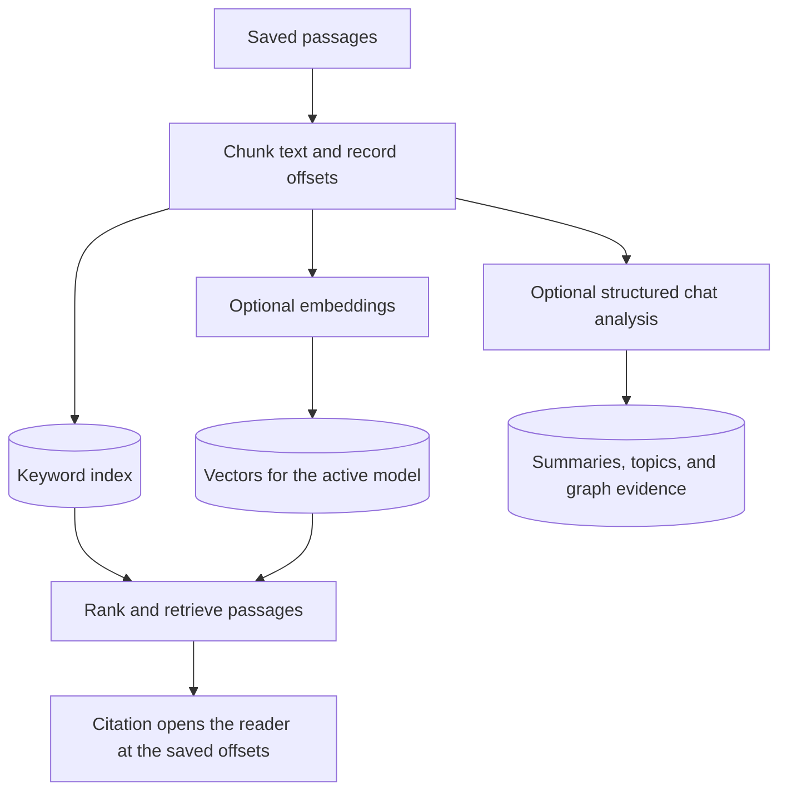

# Knowledge pipeline

Capture converts source HTML, document text, notes, or transcripts into numbered passages. The knowledge pipeline chunks passage text and records the passage indices each chunk covers. It keeps provider-generated output tied to saved evidence.

Saved content is untrusted. Prompts identify source content as evidence, and the structured adapter validates responses before storing them. Failed optional model calls leave saved reading accessible. Keyword search stays available during embedding rebuilds. [Search and citations](search.md)
