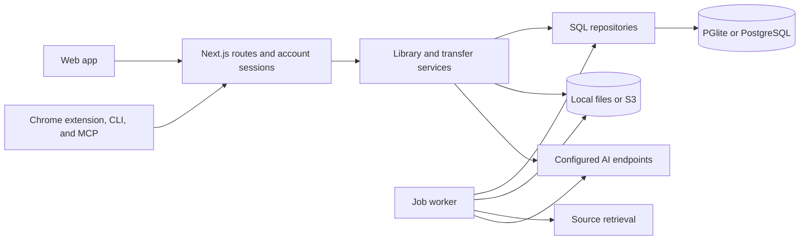

# Architecture

Next.js serves the UI and the HTTP API. Route handlers validate requests, check identity, and call server services. Those services own library operations and coordinate repositories, storage, provider adapters, and background work. The HTTP layer owns response formats, cookies, and streaming encodings. The repository layer owns SQL and data scoping. Shared modules hold data contracts and logic that can run in both browser and server.

Lite runs the web process and job loop together on PGlite. It stores the database and files under `DATA_DIR`. Standard runs web and worker processes against the same PostgreSQL database. Both processes share access to originals and transfers.

Every user-owned item, highlight, citation, conversation, and integration key resolves against the authenticated account. Exports verify originals by content digest and the importer remaps internal references to the receiving library.

## Workspace and library

Library, Chat, Graph, Highlights and Settings share the fixed workspace rail. Below 768px, the five primary actions move into a bottom tab bar. The Reader keeps its own header for appearance, reading progress and navigation.

The library displays one grid of equal-height cards, with the newest saves first. A fixed Topics panel shows account-wide counts and filters the grid. Below 1024px the panel opens as a modal drawer. Cards share a detail dialog and action menu across content types. The library uses a stable date and item ID cursor to load additional items.

- [Background jobs](jobs.md)
- [Knowledge pipeline](knowledge-pipeline.md)
- [Reader](reader.md)
- [Search and citations](search.md)
- [Architecture decisions](../decisions/)
