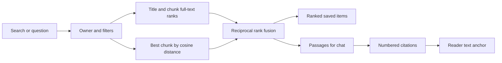

# Library search and citations

Search scopes candidate items to the signed-in account and applies type, tag, topic, saved-date and import-status filters before ranking. Full-text search uses PostgreSQL's English dictionary and `websearch_to_tsquery`. Titles and the strongest matching chunk contribute to the lexical item rank. A short metadata match also makes brand names, exact URLs and recently saved content searchable while chunks are being indexed.

When an embedding model is configured, semantic search sends the query to that model. PostgreSQL ranks stored vectors by cosine distance using the pgvector HNSW index. The library collapses candidate chunks to one rank per item before fusion. For ranking, each item earns `1 / (60 + rank)` from each list where it appears. The web library orders matching items newest first and pages by timestamp and item ID. Relevance-ranked API callers also include rank in the cursor.

Keyword retrieval stays available when the embedding provider is off, fails, or needs a rebuild. First-run settings record the vector dimension. Rebuilding embeddings keeps lexical chunks available while the worker regenerates the vectors.

Chat retains the strongest passages for each item, with up to three passages per result item and twelve passages in total. Broad questions can draw from recent items. Saved graph evidence can contribute related passages when applicable. The model receives numbered passages and instructions to cite each claim. The app resolves citation numbers to saved anchors and checks that a cited span still matches the stored quotation when a conversation reopens. Clicking a citation opens the item and scrolls to that passage.
